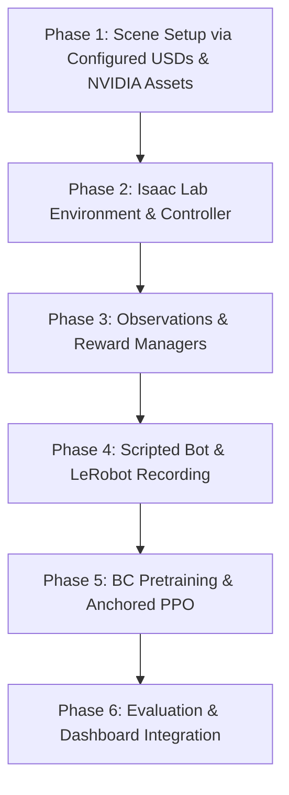

# Developer Implementation Plan: UR10e Adaptive Sorting in Isaac Sim / Isaac Lab

## Executive Summary
This document provides a complete, developer-ready implementation plan for porting the **UR10e Adaptive Sorting** system from the current MuJoCo + CPU pipeline to **NVIDIA Isaac Sim / Isaac Lab**.

The task objective remains identical:
> A Universal Robots **UR10e** arm equipped with a **Robotiq 2F-140** gripper must identify, grasp, and sort two distinct parts (an **L-bracket** into **Bin A** and an **M20 bolt** into **Bin B**) using vision and proprioceptive state, trained via **Imitation Learning (Behavior Cloning) + PPO with an In-Loss BC Anchor**.

---

## 1. Feasibility Assessment: Can It Be Implemented the Same Way?

**Yes.** Not only can it be implemented the same way, but Isaac Lab is natively designed for this exact workflow.

### What Translates 1:1:
1. **The Task MDP (Markov Decision Process)**:
   - **Observation Space**: Same 64 x 64 overhead RGB camera image + 44-d state vector (proprioception + privileged part/bin poses + target indicators).
   - **Action Space**: Same 7-DoF action vector (`dX`, `dY`, `dZ`, locked `dRx`/`dRy`, `dRz`, binary Robotiq 2F-140 gripper).
2. **The Reward Function**:
   - The same potential-based shaping formulation ($\Delta \Phi_{\text{approach}}$, $\Delta \Phi_{\text{lift}}$, $\Delta \Phi_{\text{transport}}$), sparse completion bonuses, and release/push penalties.
3. **The Hybrid Training Strategy**:
   - Collecting demonstrations -> Behavior Cloning (BC) initialization -> PPO fine-tuning with an in-loss BC anchor to prevent catastrophic forgetting.
4. **LeRobot Integration**:
   - Rollouts can still be streamed and logged directly into Hugging Face `LeRobotDataset` v3.0 format.

### Key Architectural Differences & Improvements:

| Dimension | Current MuJoCo Setup | Isaac Sim / Isaac Lab Port |
|---|---|---|
| **Simulation Backend** | MuJoCo (CPU, C API) | PhysX 5 on GPU (Omniverse / Tensor API) |
| **Parallelism** | 12 CPU processes (`SubprocVecEnv`) | **256 to 4,096 parallel environments** on a single GPU |
| **Throughput** | ~600 steps/sec (CPU bound) | **15,000 to 80,000+ steps/sec** (GPU parallel) |
| **Camera Rendering** | Mesa EGL (CPU-to-iGPU) | Vulkan / RTX Tiled Camera Sensors on GPU |
| **IK Controller** | Damped Least-Squares in NumPy ([`workcell_sim.py`](file:///home/smglabspark/new_isaac/adaptive-sorting/simulation/environments/workcell_sim.py)) | GPU-batched `DifferentialIKController` (`omni.isaac.lab.controllers`) |
| **Scene Representation** | MJCF ([`scene.xml`](file:///home/smglabspark/new_isaac/adaptive-sorting/simulation/mujoco/scene.xml), [`ur10e.xml`](file:///home/smglabspark/new_isaac/adaptive-sorting/simulation/robots/ur10e.xml) / [`ur10e_2f140.xml`](file:///home/smglabspark/new_isaac/adaptive-sorting/simulation/robots/ur10e_2f140.xml)) | Native OpenUSD (`.usd` / `.usdc`) directly leveraging `Isaac-Pick-Place-Bin-to-Bin-UR10e-Play-v0` and NVIDIA Nucleus assets (no XML conversion needed) |
| **Data Flow** | NumPy arrays <-> PyTorch tensors | Pure PyTorch GPU tensors end-to-end |

---

## 2. Target Technology Stack & Dependencies

- **Simulation Engine**: NVIDIA Isaac Sim (version >= 4.2.0 or 2023.1.1+)
- **RL Framework**: **Isaac Lab** (`omni.isaac.lab`, formerly Orbit)
- **RL Engine Options**:
  - *Option A (Recommended for exact parity)*: **Stable-Baselines3** via Isaac Lab's Gymnasium Vector Wrapper.
  - *Option B (Recommended for maximum speed)*: **`rsl_rl`** or **`skrl`** (customized with the BC anchor loss on GPU).
- **Dataset / Imitation**: Hugging Face `lerobot` (0.6.x+)
- **Physics Backend**: PhysX GPU with GPU tensor pipelines enabled.

---

## 3. Phase-by-Phase Developer Implementation Plan



---

### Phase 1: Scene Setup via Configured USDs & NVIDIA Assets
**Goal**: Assemble the workcell using existing, pre-validated OpenUSD assets from the `Isaac-Pick-Place-Bin-to-Bin-UR10e-Play-v0` environment ([`pick_place_joint_pos_env_cfg.py`](file:///home/smglabspark/new_isaac/IsaacLab/source/isaaclab_tasks/isaaclab_tasks/manager_based/manipulation/lift/config/ur10e/pick_place_joint_pos_env_cfg.py)), supplementing any missing objects with standard NVIDIA-provided assets in Isaac Sim / Nucleus instead of converting MuJoCo XML files.

1. **UR10e Robot & Robotiq 2F-140 Gripper (Pre-configured USD)**:
   - **No XML conversion required**: Directly reuse the fully articulated, PhysX-tuned USD configuration from [`UR10E_ROBOTIQ_2F_140_CFG`](file:///home/smglabspark/new_isaac/IsaacLab/source/isaaclab_tasks/isaaclab_tasks/manager_based/manipulation/lift/config/ur10e/joint_pos_env_cfg.py#L38-L60):
     - Asset path: `https://omniverse-content-production.s3-us-west-2.amazonaws.com/Assets/Isaac/5.1/Isaac/Samples/Rigging/Manipulator/import_manipulator/ur10e/ur/ur_gripper.usd` (or local cached asset in `/home/smglabspark/new_isaac/ur_gripper`).
     - Includes integrated UR10e arm + Robotiq 2F-140 parallel gripper with articulation root properties, rigid body schemas, drive damping, and calibrated joint limits (`shoulder_.*`, `elbow_.*`, `wrist_.*`, and `finger_joint`).
     - Solver iterations configured for high stability: `solver_position_iteration_count = 16`, `solver_velocity_iteration_count = 1` for reliable grasping without pinch slip.

2. **Workcell & Dual Sorting Bins (Pre-configured USD)**:
   - **Industrial Worktable**: Built-in Isaac Lab table asset spawned from standard Isaac Sim library (via `LiftEnvCfg`).
   - **Source & Target Sorting Bins**: Directly reuse the blue sorting bin asset configured in `UR10eCubeBinToBinEnvCfg`:
     - USD path: `f"{ISAACLAB_NUCLEUS_DIR}/Mimic/nut_pour_task/nut_pour_assets/sorting_bin_blue.usd"`
     - Parameters: `scale = (2.0, 2.0, 2.0)`, kinematic physics enabled (`kinematic_enabled = True`), positioned at `[0.48, 0.22, 0.0]` (Source Bin) and `[0.48, -0.22, 0.0]` (Target Bin), rotated 90 deg around Z to accommodate the table layout.
   - **Subterranean Holding Floor**: Reuse the holding floor plane asset (`AssetBaseCfg` at `z = -10.05 m`) from `UR10eCubeBinToBinEnvCfg` to cleanly hold inactive/stashed objects out of freefall and active collision space.

3. **Task Objects Strategy**:
   - **Existing Configured USD Objects**:
     - **M20 Bolt**: Directly leverage `/home/smglabspark/new_isaac/factory_bolt_m20.usd` (pre-configured with mass 0.25 kg, rigid body solver count 16, and Continuous Collision Detection / CCD enabled).
     - **Bolt Coupler**: Directly leverage `/home/smglabspark/new_isaac/BoltCopuler_1.usdc` (pre-configured with high friction, mass 0.25 kg, and tuned damping).
     - **DexCube**: Directly leverage `f"{ISAAC_NUCLEUS_DIR}/Props/Blocks/DexCube/dex_cube_instanceable.usd"`.
   - **Missing / Additional Objects (NVIDIA Isaac Sim Assets)**:
     - For items not currently on disk (e.g., L-bracket or alternative sorting targets), **do not convert MuJoCo XML files**. Instead, directly leverage NVIDIA-provided assets:
       - **NVIDIA Isaac Sim Props & Factory Assets**: Inspect and reference assets under `{ISAAC_NUCLEUS_DIR}/Props/` or `{ISAACLAB_NUCLEUS_DIR}/Factory/` (e.g., factory bolts, nuts, gears, industrial brackets).
       - **Procedural / Shape Primitives**: For custom dimensions (such as the 120 x 60 x 12 mm L-bracket), compose via Isaac Sim / Isaac Lab rigid body shape primitives (`sim_utils.CuboidCfg` or compound USD shapes with collision APIs) or standard industrial USD models provided in the Isaac Sim asset library.
     - Add PhysX contact materials: static/dynamic friction $\mu = 1.0$ - $1.6$, restitution $0.0$, and light linear/angular damping (linear 0.5, angular 0.005).

4. **Overhead Camera**:
   - Place an Isaac Sim camera sensor at `[x=0.175, y=0.0, z=2.0]`, pointing directly down (-Z).
   - Resolution: 64 x 64 RGB (utilize `omni.isaac.lab.sensors.TiledCamera` for multi-env batched GPU rendering directly in VRAM).

---

### Phase 2: Environment & Controller Setup (Isaac Lab)
**Goal**: Implement the core `ManagerBasedRLEnv` in Isaac Lab with batched Inverse Kinematics, building directly on `UR10eCubeBinToBinEnvCfg`.

1. **Environment Configuration (`sorting_env_cfg.py`)**:
   - Subclass `UR10eCubeBinToBinEnvCfg` (or adapt its pre-validated scene and multi-object asset configuration).
   - Set control frequency to **10 Hz** (`decimation = 10` with physics stepping at `100 Hz` / 0.01 s or `decimation = 100` with physics at 1 ms).
2. **Action Space & Batched Differential IK**:
   - Use Isaac Lab’s `DifferentialIKControllerCfg` from `omni.isaac.lab.controllers`:
     ```python
     ik_controller_cfg = DifferentialIKControllerCfg(
         command_type="pose",
         use_relative_mode=True,
         ik_method="dls",  # Damped Least Squares
         damping_factor=0.01,
     )
     ```
   - **Action Manager**:
     - Consumes 7-d action tensor: `[dx, dy, dz, droll, dpitch, dyaw, gripper]`.
     - Scale translations by `max_delta_pos = 0.05` m.
     - Enforce zero scale on roll/pitch deltas (keep Robotiq 2F-140 gripper pointing downward).
     - Scale yaw by `max_delta_rot = 0.35` rad.
     - Threshold Robotiq 2F-140 gripper command: `> 0 -> close` (stroke 255.0), `<= 0 -> open` (stroke 0.0).
     - Clamps joint velocity targets against UR10e datasheet limits.

---

### Phase 3: Observation & Reward Managers
**Goal**: Match the 44-d state representation, overhead visual inputs, and exploit-free reward logic.

1. **Observation Manager (`ObservationManagerCfg`)**:
   - **Group `policy`**:
     - `overhead_cam`: `TiledCamera` sensor returning `(N, 64, 64, 3)` `uint8` images directly in GPU VRAM.
     - `state`: Concatenated `(N, 44)` float tensor matching [`build_state_layout`](file:///home/smglabspark/new_isaac/adaptive-sorting/simulation/environments/sorting_env.py#L23-L33):
       - Arm joint positions (6) and joint velocities (6 x 0.2).
       - Robotiq 2F-140 gripper aperture (1).
       - TCP position (3) and yaw orientation `[sin(psi), cos(psi)]` (2).
       - Bracket position (3) and yaw (2).
       - Bolt position (3) and yaw (2).
       - Bin A center (3) and Bin B center (3).
       - Target object one-hot indicator (2).
       - Relative vector TCP -> target (3).
       - Relative vector target -> bin (3).
       - Stage flags: `grasped_flag` (1), `lifted_flag` (1).
2. **Reward Manager (`RewardManagerCfg`)**:
   - Implement the potential-based logic from [`training/rewards/sorting_reward.py`](file:///home/smglabspark/new_isaac/adaptive-sorting/training/rewards/sorting_reward.py):
     - **Approach Potential**: $\Phi_a = (1 - \tanh(8.0 \cdot d_{\text{tcp\_to\_tgt}})) \cdot (1 - 0.5 \cdot (1 - |\cos(d_\psi)|))$.
     - **Lift Potential**: $\Phi_l = \text{clip}(h_{\text{tgt}} / 0.15, 0, 1)$ (active only after first grasp; charged back if dropped).
     - **Transport Potential**: $\Phi_t = 1 - \tanh(4.0 \cdot d_{\text{tgt\_to\_bin}})$.
     - **Sparse Event Bonuses**: +10 first grasp, +15 first lift, +60 placement, +40 full sort.
     - **Penalties**: Release outside bin (-15), push ungrasped part (-0.2 x speed), collisions, time penalty.
3. **Reset & Reverse Curriculum (`EventManagerCfg`)**:
   - Reset distributions across the parallel environments:
     - 30% from Home Pose.
     - 15% Hover above part (3–12 cm).
     - 20% Straddle with open Robotiq 2F-140 gripper around part.
     - 20% Grasped and lifted above table.
     - 15% Carried directly over the target bin.

---

### Phase 4: Demonstration Collection & LeRobot Writer
**Goal**: Record successful demonstration trajectories natively into LeRobotDataset format.

1. **Scripted Controller in Isaac Lab**:
   - Port `ScriptedSortingController` ([`training/demos/scripted_controller.py`](file:///home/smglabspark/new_isaac/adaptive-sorting/training/demos/scripted_controller.py)) to query GPU actor root states (`env.scene.rigid_object["bracket"].data.root_pos_w`).
   - Run the 8-state state machine (`hover` -> `descend` -> `close` -> `lift` -> `transport` -> `lower` -> `open` -> `retreat`).
   - Because Isaac Lab runs in parallel, **you can record 100+ demonstrations in a single 10-second pass** instead of recording them sequentially.
2. **LeRobot Dataset Output**:
   - Use `LeRobotEpisodeRecorder` ([`lerobot_adapter/demo_recorder.py`](file:///home/smglabspark/new_isaac/adaptive-sorting/lerobot_adapter/demo_recorder.py)) to write the collected trajectories to [`datasets/demos/`](file:///home/smglabspark/new_isaac/adaptive-sorting/datasets/demos/) in standard LeRobot v3.0 format (`data/*.parquet` + `images/*.png`).

---

### Phase 5: Imitation Learning + PPO with BC Anchor on GPU
**Goal**: Implement the hybrid training pipeline on GPU tensors.

```
       [Demonstrations (LeRobot)]
                   │
                   ▼
       ┌────────────────────────┐
       │ Step 1: BC Pretraining │  (NatureCNN + MLP Actor-Critic)
       └───────────┬────────────┘
                   │ Direct Weight Transfer
                   ▼
       ┌────────────────────────┐
       │ Step 2: VecNormalize   │  (Seeded from Demos & Frozen)
       └───────────┬────────────┘
                   │
                   ▼
       ┌─────────────────────────────────────────────────┐
       │ Step 3: PPOWithBC on GPU (Isaac Lab)           │
       │                                                 │
       │   Total Loss = PPO_Clip + Entropy + Value_Loss  │
       │              + bc_coef(t) * MSE(pi_mean, a_demo)│
       └─────────────────────────────────────────────────┘
```

1. **BC Pretraining Script ([`training/bc_pretrain.py`](file:///home/smglabspark/new_isaac/adaptive-sorting/training/bc_pretrain.py))**:
   - Load demo transitions into GPU memory.
   - Seed observation and reward normalization statistics from the demos.
   - Run 40 epochs of Adam optimization on the `MultiInputPolicy` network:
     $$\mathcal{L} = \text{MSE}(\mu(s), a_{\text{demo}}) + 0.5 \cdot \text{MSE}(V(s), R_{\text{demo}})$$
2. **Anchored PPO on Isaac Lab ([`training/policies/ppo_bc.py`](file:///home/smglabspark/new_isaac/adaptive-sorting/training/policies/ppo_bc.py))**:
   - Integrate `PPOWithBC` with Isaac Lab's PyTorch vector environments.
   - In each PPO minibatch, sample a batch of 256 demonstration frames and add:
     $$\mathcal{L}_{\text{BC\_anchor}} = \beta(t) \cdot \text{MSE}(\mu(s_{\text{demo}}), a_{\text{demo}})$$
   - Configure anchor schedule: $\beta_0 = 1.0$, decaying linearly over 1M steps to a floor $\beta_{\text{floor}} = 0.25$.
   - Enforce `target_kl: 0.02` for early stopping per epoch.

---

### Phase 6: Telemetry, Evaluation, and Dashboards
1. **Periodic Evaluation Protocol**:
   - Every 50k steps, trigger a detached evaluation of 50 episodes with 100% home-pose resets and full randomization.
   - Automatically tag and maintain the **`best`** checkpoint (by full completion rate).
2. **Visualization & Live Streaming**:
   - Isaac Sim provides built-in WebRTC streaming (`omni.services.streamclient.webrtc`).
   - The React frontend from this repo can connect directly to Isaac Sim's WebRTC or WebSocket stream for live camera view, real-time metrics, and teleop control.

---

## 4. Key Gotchas & Solutions for Isaac Sim

| Challenge in Isaac Sim | Root Cause | Solution |
|---|---|---|
| **Pinch Slip / Bolt Tunneling** | PhysX solver iterations too low for thin contacts. | Set `solver_position_iteration_count >= 16` and `solver_velocity_iteration_count >= 4` on the Robotiq 2F-140 gripper and bolt prims. Enable Continuous Collision Detection (CCD) on the bolt. |
| **Camera Rendering Slowdown** | Individual camera reads cause GPU-to-CPU synchronization bottlenecks. | Use Isaac Lab’s `TiledCamera` sensor. It keeps all rendered frames in a single batched GPU tensor without round-tripping to CPU host RAM. |
| **Robotiq Gripper Elastic Bouncing** | Default PhysX compliance makes fingers feel springy. | Set finger drive damping high ($k_d \ge 500$), use rigid material properties with zero restitution, and enable contact friction patch averaging. |
| **Observation Dot Notation** | Isaac Lab dictionary keys and PyTorch Modules. | Maintain the [`SB3KeyAlias`](file:///home/smglabspark/new_isaac/adaptive-sorting/simulation/environments/sorting_env.py#L374-L388) pattern: internally use `image` and `state`, exposing LeRobot `observation.images.overhead` and `observation.state` at the export boundary. |

---

## 5. Developer Checklist & Milestones

- [ ] **Milestone 1: Scene Setup via Configured USDs & NVIDIA Assets (Day 1–2)**
  - [ ] Reused UR10e + Robotiq 2F-140 USD (`ur_gripper.usd`) already configured in `Isaac-Pick-Place-Bin-to-Bin-UR10e-Play-v0`.
  - [ ] Reused dual bins (`sorting_bin_blue.usd`) and existing USD parts (`factory_bolt_m20.usd`, `BoltCopuler_1.usdc`, `dex_cube_instanceable.usd`).
  - [ ] Sourced any missing assets (such as L-bracket or industrial parts) directly from NVIDIA Isaac Sim / Nucleus asset libraries without converting XMLs.
  - [ ] Overhead camera positioned and verified at 64 x 64 using `TiledCamera`.
- [ ] **Milestone 2: Isaac Lab Environment & IK (Day 3–4)**
  - [ ] Differential IK controller tracks Cartesian delta commands accurately.
  - [ ] Action space and 44-d observation vector parity verified against MuJoCo outputs.
  - [ ] Potential-based reward functions registered in `RewardManagerCfg`.
- [ ] **Milestone 3: Demonstrations & LeRobot Storage (Day 5)**
  - [ ] Port `ScriptedSortingController` ([`training/demos/scripted_controller.py`](file:///home/smglabspark/new_isaac/adaptive-sorting/training/demos/scripted_controller.py)) to Isaac Lab actors.
  - [ ] Record 50+ successful parallel episodes into LeRobot format.
- [ ] **Milestone 4: BC Pretraining & Normalization (Day 6)**
  - [ ] Pretrain the shared `MultiInputPolicy` to $\le 0.04$ action MSE.
  - [ ] Verify `VecNormalize` parameters seeded from demos and frozen.
- [ ] **Milestone 5: Anchored PPO Scaling (Day 7–8)**
  - [ ] Run `PPOWithBC` with 256 parallel environments on GPU.
  - [ ] Verify non-zero anchor floor (0.25) prevents catastrophic forgetting.
  - [ ] Achieve $\ge 70\%$ full sorting success rate on clean evaluation sets.
- [ ] **Milestone 6: Checkpointing & Export (Day 9)**
  - [ ] Wrap final checkpoint in `SortingRLPolicy` ([`lerobot_adapter/policy.py`](file:///home/smglabspark/new_isaac/adaptive-sorting/lerobot_adapter/policy.py)) with `select_action(batch)` API.
  - [ ] Validate cross-framework deployment.
