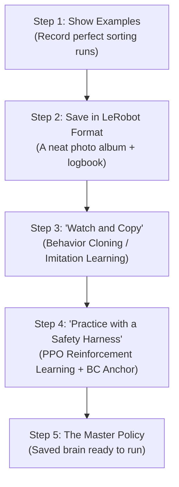

# The Layman's Guide to Training the UR10e Sorting Robot

If you're not an AI researcher or robotics PhD, machine learning terminology like *PPO, GAE, NatureCNN, VecNormalize,* and *Markov Decision Processes* can sound like alphabet soup.

This guide explains **how this project trains the UR10e robotic arm** using simple, everyday analogies.

---

## 1. The Big Picture: What is the Goal?

Imagine a factory worktable with:
1. A **Universal Robots UR10e** arm hanging over a table with a **Robotiq 2F-140** gripper.
2. Two parts randomly tossed on the table: an **L-shaped metal bracket** and a **bolt**.
3. Two blue bins: **Bin A** and **Bin B**.

**The Job**: The robot must look at the table, pick up the bracket and drop it into Bin A, then pick up the bolt and drop it into Bin B.

```
       [Overhead Camera]
              │
              ▼
       ┌───────────────┐
       │   UR10e Arm   │
       └───────┬───────┘
               │ (Robotiq 2F-140 Gripper)
               ▼
   [Bracket]       [Bolt]
      │              │
      ▼              ▼
   [Bin A]        [Bin B]
```

---

## 2. Why Can't We Just Let the Robot "Figure It Out"? (The Toddler Problem)

In pure Reinforcement Learning (RL), the robot starts with a completely blank brain and tries random motions, getting points ("rewards") when it does something good and losing points when it does something bad.

**Why that fails here**:
Picking up a small 20 mm bolt with the Robotiq 2F-140 gripper fingers using real physics is like asking a blindfolded person to thread a needle purely by flailing their hands around. 
* 99.99% of the time, the fingers either hit the table, bump the bolt away, or close on empty air.
* The robot almost never accidentally picks up the bolt, so it never gets a positive reward to learn from.

To fix this, we use the **Apprentice Model**:
1. First, **show the robot how a master does it** (Imitation Learning).
2. Then, **let the robot practice on its own to get faster and smoother** (Reinforcement Learning).

---

## 3. The Step-by-Step Training Recipe



---

### Step 1: Record Examples ("The Demonstrations")
Before teaching the neural network, we need examples of successful sorts.
We get these from a **Scripted Bot**:
* We have a simple, hardcoded Python program ([scripted_controller.py](file:///home/smglabspark/new_isaac/adaptive-sorting/training/demos/scripted_controller.py)) that "cheats" by looking directly at the simulator's internal memory to know the exact coordinates of the bolt and bracket.
* It follows a basic checklist:
  * Move hand above part -> Descend -> Squeeze fingers -> Lift up -> Fly over bin -> Open fingers.
* We record about 30 of these successful runs so the AI has textbook examples to study.

---

### Step 2: Store in the LeRobot Format ("The Photo Album")
**What is LeRobot?**
Think of [Hugging Face's LeRobot](https://github.com/huggingface/lerobot) as an industry-standard **filing cabinet / video recorder format** for robotics. 

Instead of saving data in messy custom text files, our environment automatically packages every episode into a clean folder containing:
* **The Pictures**: What the overhead camera saw at each frame.
* **The Logbook (Parquet table)**: Where the robot's arm was, what its fingers were doing, and what command it sent.
* **The Goal**: A text description ("*Pick the bracket into Bin A and the bolt into Bin B*").

*Note: LeRobot is used here as the **data storage standard** and **model wrapper**, while the actual brain training is powered by Stable-Baselines3.*

---

### Step 3: "Watch and Copy" (Behavior Cloning)
Now we start training the robot's neural network brain.
* We feed the recorded runs into the neural network.
* We show it: *"When the camera looked like this, and your arm was here, the expert moved 2 cm to the left and closed the gripper."*
* The network adjusts its math to copy the expert's moves.
* We also teach it what "success feels like" by having it predict how close it is to finishing the job.

**The result after this step**:
The robot can now grasp parts ~70% to 90% of the time! But it's stiff and easily confused if a part ends up in a slightly weird spot it hasn't seen before.

---

### Step 4: "Practice and Refine" (Reinforcement Learning with PPO)
To make the robot adaptable, we let it practice in 12 parallel virtual simulation rooms simultaneously using an algorithm called **PPO** (Proximal Policy Optimization).

#### The Trap We Encountered: "Catastrophic Forgetting"
When we first let PPO practice after copying the demonstrations, something terrible happened:
* Because PPO adds random exploratory wiggles to discover new tricks, the robot made wild moves early on.
* Within a short time, it **completely forgot** how to pick up the parts! Its grasp success crashed from 90% down to 20%.

#### The Solution: The "In-Loss Anchor" (Keeping One Hand on the Textbook)
To prevent the robot from forgetting, we added a rule to every practice session:
> *"While you practice and explore, you MUST also look at a flashcard from the expert demonstrations. If your actions stray too far from what the expert would do, you get penalized."*

This penalty (called the **BC Anchor**) starts strong and gently relaxes over 1 million practice steps, but **never drops to zero**. 
* Result: The robot retains its ability to pick up parts while learning how to smoothly fly them over and release them into the bins. Full sorting success jumped to **60%–70%**!

---

## 4. What Are the Inputs? (What Does the Robot "Sense"?)

At every tick of the clock (10 times each second), the robot's neural network brain receives two rich sources of information: **its eyes** (a camera picture) and **its dashboard** (a list of 44 precise sensor numbers).

```
                        ┌──────────────────────────────────────────────┐
                        │              What the Robot Senses           │
                        └──────────────────────┬───────────────────────┘
                                               │
                       ┌───────────────────────┴───────────────────────┐
                       ▼                                               ▼
         ┌───────────────────────────┐                   ┌───────────────────────────┐
         │     1. The Overhead Eye   │                   │  2. The 44-Number Sensor  │
         │   (64 x 64 Color Picture) │                   │        Dashboard          │
         └─────────────┬─────────────┘                   └─────────────┬─────────────┘
                       │                                               │
                       ▼                                               ▼
             Overhead view of table,                      Proprioception, Object Poses,
             parts, bins, & Robotiq 2F-140 gripper        Target Flags, & Navigation Vectors
```

### 1. The Eyes: Overhead Camera (64 × 64 Color Image)
* A virtual camera sits directly above the table looking straight down.
* It captures a compact **64-pixel by 64-pixel color image (RGB)**.
* **Why so small?** High-resolution video takes enormous compute power and slows down learning. A 64 × 64 thumbnail is lightweight enough for lightning-fast training while providing just enough detail to spot the bolt, bracket, bins, and Robotiq 2F-140 gripper position.
* **Visual Robustness**: During training, we randomly adjust lighting and add slight pixel static so the AI doesn't get confused by subtle shadows or lighting changes in the room.

### 2. The Dashboard: 44 Sensor Numbers (Proprioception & GPS)
Just like an airplane pilot has cockpit instruments, the robot receives 44 exact numbers describing its body and surroundings:

| Sensor Group | Count | What It Tells the Robot | Everyday Analogy |
|---|:---:|---|---|
| **Arm Joint Angles** | 6 | Exact rotational position of each of the 6 motors (`shoulder_pan`, `shoulder_lift`, `elbow`, etc.). | "Where my joints are bent right now." |
| **Arm Joint Speeds** | 6 | Angular velocity of each motor (scaled down for stability). | "How fast each part of my arm is swinging." |
| **Robotiq 2F-140 Gripper Opening** | 1 | Distance between finger pads (0.0 = fully shut, 1.0 = fully open at 140 mm). | "Are my fingers open or closed?" |
| **Hand 3D Position** | 3 | `(X, Y, Z)` position of the fingertip pinch point in meters. | "Where my hand is in 3D room space." |
| **Hand Yaw Angle** | 2 | Sine and cosine of the hand's rotation angle over the table. | "Which direction my wrist is twisted." |
| **Bracket 3D Pose** | 5 | `(X, Y, Z)` coordinates + rotation angle of the L-bracket. | "Where the bracket is sitting and how it's oriented." |
| **Bolt 3D Pose** | 5 | `(X, Y, Z)` coordinates + rotation angle of the bolt. | "Where the bolt rolled to and how it's oriented." |
| **Bin A 3D Position** | 3 | `(X, Y, Z)` center of the blue bracket bin. | "Where Bin A is sitting on the table." |
| **Bin B 3D Position** | 3 | `(X, Y, Z)` center of the blue bolt bin. | "Where Bin B is sitting on the table." |
| **Target Work Order** | 2 | `[1, 0]` means "sort the bracket"; `[0, 1]` means "sort the bolt". | "My active task assignment." |
| **Distance to Target** | 3 | `(X, Y, Z)` vector from the hand straight to the active part. | "A 3D compass arrow pointing right to the target." |
| **Distance to Bin** | 3 | `(X, Y, Z)` vector from the active part to its destination bin. | "A 3D compass arrow pointing right to the drop bin." |
| **Grasp & Lift Flags** | 2 | `grasped_flag` (1 or 0) and `lifted_flag` (1 or 0). | "Do I have a solid grip on it, and is it off the table?" |
| **Total Dashboard** | **44** | | |

*Before entering the neural network, all 44 numbers are normalized so that large numbers (like millimeter coordinates) don't drown out small numbers (like 0-or-1 flags).*

---

## 5. What Are the Outputs? (What Can the Robot Move?)

Every 0.1 seconds (10 times a second), the AI outputs **7 steering numbers**, all scaled between **-1.0 and +1.0**:

```
  ┌────────────────────────────────────────────────────────────────────────┐
  │                        The 7 Action Numbers                            │
  ├─────────────────────────────┬───────────────────────────┬──────────────┤
  │       Hand Movement         │       Hand Rotation       │   Fingers    │
  │     [ dX,   dY,   dZ ]      │    [ dRx,  dRy,  dRz ]    │  [ Gripper ] │
  │ Up/Down, Left/Right, Back/Fwd│ Roll/Pitch (locked), Yaw  │ Open / Close │
  └─────────────────────────────┴───────────────────────────┴──────────────┘
```

### The 7 Movement Channels:
1. **Nudge Hand in 3D Space (`dX, dY, dZ`)**:
   * How far to move the fingertips in the table coordinate frame.
   * Scaled up to **5 cm per step** (a maximum speed of 0.5 meters per second).
   * Automatically clamped within a safety box so the arm never crashes into the table or reaches beyond its workspace.
2. **Rotate Hand (`dRx, dRy, dRz`)**:
   * **Roll & Pitch are locked to 0**: The Robotiq 2F-140 gripper is kept pointing straight down at the tabletop so it is always ready to pinch without tilting awkwardly.
   * **Yaw (`dRz`) can twist up to ~20° per step**: This lets the fingers rotate to match the exact angle of the bolt or bracket before clamping down.
3. **Pinch or Release (`Robotiq 2F-140 Gripper`)**:
   * Operates as a decisive **binary switch**:
     * Greater than 0 $\rightarrow$ **Squeeze tightly** with full force.
     * Less than or equal to 0 $\rightarrow$ **Open wide** to the full 140 mm aperture.
   * Using a binary switch prevents the robot from hesitating with weak, loose grips that let parts slip out.

### The Low-Level Chauffeur: Inverse Kinematics (IK)
The neural network doesn't have to calculate individual motor torques or angles. It just says: *"Move the hand 2 cm forward and twist 5° clockwise."*
* A built-in mathematical translator called **Damped Least-Squares Inverse Kinematics (IK)** figures out how all 6 arm motors must rotate together to move the hand to that spot.
* A **Safety Governor** monitors the UR10e factory speed limits (120°/s on the shoulder joints, 180°/s on the wrists). If any movement would exceed these limits, it automatically and smoothly slows down the entire arm without changing the path of travel.

---

## 6. What Data is Being Leveraged?

To turn this into a competent worker, the system combines three data streams:

1. **Demonstration Replays**: High-quality examples of successful sorts (both scripted and human teleoperated).
2. **Real-Time Physics Simulations**: 12 parallel MuJoCo simulations testing real contacts, friction, and gravity.
3. **Reward Points (Carrot & Stick)**:
   * **Carrot**: Points for reaching toward the part, bonus points for grasping, bonus points for lifting, and big jackpots (+60 points) for dropping parts into the right bin.
   * **Stick**: Penalties for bumping parts away carelessly, penalties for dropping parts halfway, penalties for hitting the wrong bin, and penalties for taking too long.

---

## 7. Summary in One Paragraph

To train the UR10e arm, we don't start from scratch. First, we record successful sorting runs using a scripted helper program and save them into the standardized **LeRobot dataset format**. Next, we make the AI **copy the expert** (Behavior Cloning), which gives it an instant knack for grasping. Finally, we let it **practice in 12 parallel virtual worlds** (PPO Reinforcement Learning) while forcing it to keep an eye on the textbook (the **BC Anchor**) so it doesn't forget how to pick while learning how to place. The resulting policy takes in a **64 x 64 overhead camera view** and a **44-number sensor vector**, and outputs **hand movement deltas and Robotiq 2F-140 gripper squeeze commands** 10 times a second.
