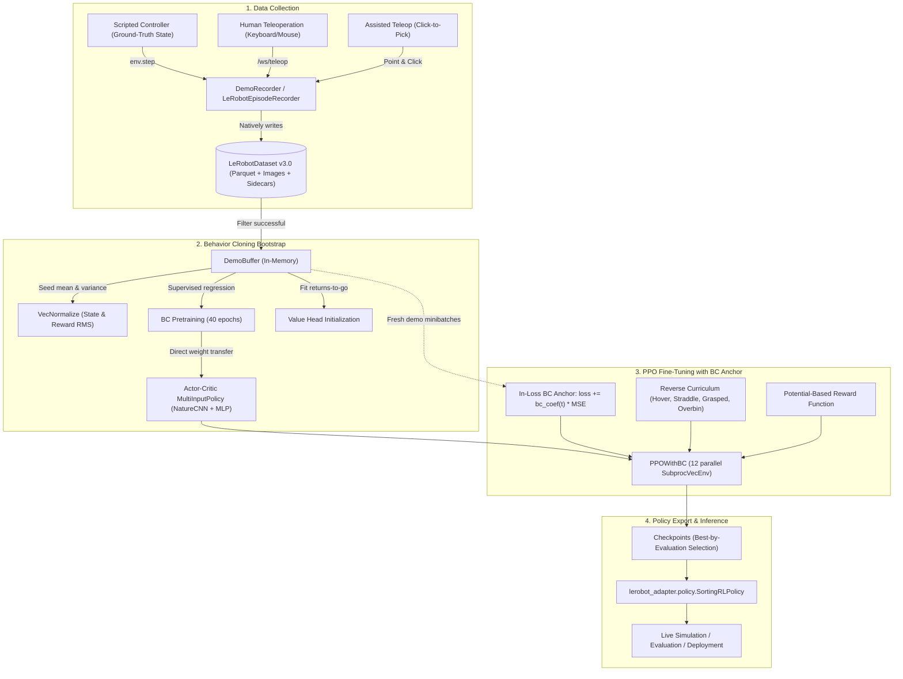

# UR10e Policy Training & Architecture Guide

This document breaks down the end-to-end policy training pipeline for the Universal Robots **UR10e** robotic arm equipped with the **Robotiq 2F-140** gripper in this repository (`adaptive-sorting`). It covers:
1. **The Step-by-Step Training Pipeline** (from scripted demos to LeRobot dataset to BC + PPO).
2. **Where LeRobot Fits & Its Boundary with Stable-Baselines3**.
3. **Policy Inputs (Observations)** in full detail.
4. **Policy Outputs (Actions) & Controller Execution**.
5. **All Data & Signals Leveraged by the Policy**.
6. **The Story Behind BC + PPO**: Why naive fine-tuning failed and how the anchored solution achieved 60–70% success.

---

## 1. High-Level Summary: How Policy Training Works

Your initial intuition is essentially correct, but with a critical architectural nuance: **demonstrations are not converted after the fact**; rather, the simulation environment and recorders write directly to the native **LeRobotDataset v3.0** format during rollout. Furthermore, the combination of **Imitation Learning (Behavior Cloning)** and **PPO (Reinforcement Learning)** is executed via a unified neural network with an **in-loss BC anchor**, preventing the reinforcement learning updates from destroying what the robot learned from demonstrations.



---

## 2. Step-by-Step Training Approach

### Step 1: Demonstration Collection (Scripted & Teleoperated)
- **Scripted Demonstrations** ([`scripts/record_scripted_demos.py`](file:///home/smglabspark/new_isaac/adaptive-sorting/scripts/record_scripted_demos.py) using [`training/demos/scripted_controller.py`](file:///home/smglabspark/new_isaac/adaptive-sorting/training/demos/scripted_controller.py)):
  - A hand-coded finite-state machine (`hover` -> `descend` -> `close` -> `lift` -> `transport` -> `lower` -> `open` -> `retreat`).
  - Reads ground-truth 3D poses of parts and bins directly from MuJoCo.
  - Emits actions strictly through the **exact same 7-DoF action space** and environment wrapper as the neural policy (same IK, workspace bounds, joint velocity limits, and contact physics).
  - Used as a deterministic pipeline validator to ensure recording, data structures, and learning pipelines work before human data is introduced.
- **Human Teleoperation** (`teleop_demo` via WebSockets and React frontend):
  - Keyboard and mouse drag commands streamed at 20 Hz over `/ws/teleop`.
- **Assisted Teleop** (`assisted_demo`):
  - Click-to-pick interface where an operator clicks a part in the viewport and the scripted controller executes the trajectory.

### Step 2: Native LeRobot Dataset Recording
- Handled by [`lerobot_adapter/demo_recorder.py`](file:///home/smglabspark/new_isaac/adaptive-sorting/lerobot_adapter/demo_recorder.py) and [`lerobot_adapter/dataset_writer.py`](file:///home/smglabspark/new_isaac/adaptive-sorting/lerobot_adapter/dataset_writer.py).
- There is **no post-hoc conversion**: the recorder writes directly to a genuine **LeRobotDataset v3.0** directory structure:
  ```text
  datasets/demos/<episode_type>_<timestamp>/
      ├── data/
      │   └── chunk-000/episode_000000.parquet  # tabular observations, actions, rewards
      ├── images/
      │   └── observation.images.overhead/       # raw overhead RGB frames
      ├── meta/
      │   ├── info.json                          # LeRobot dataset metadata & feature schemas
      │   ├── episodes.jsonl                     # episode lengths & stats
      │   └── tasks.jsonl                        # natural language task description
      └── demo.json                              # sidecar: outcome, initial simulation state
  ```
- Unsuccessful or aborted demonstrations are automatically discarded or filtered (`successful_only: true`).

### Step 3: Behavior Cloning (BC) Pretraining
Implemented in [`training/bc_pretrain.py`](file:///home/smglabspark/new_isaac/adaptive-sorting/training/bc_pretrain.py):
1. **Shared Architecture / Direct Weight Transfer**:
   - Instead of training a separate standalone imitation network, BC pretraining is performed **directly on the PPO policy's own weights** (`stable_baselines3.common.policies.MultiInputPolicy`).
   - The policy combines a **NatureCNN** (processing the overhead image) with an **MLP** (processing the state vector).
2. **Normalizer Seeding & Freezing**:
   - Demonstrations compute the initial mean and variance for observation state normalization (`VecNormalize.obs_rms`).
   - These statistics are **frozen** during fine-tuning so the policy's input space does not shift as the agent explores.
3. **Actor Regression**:
   - Supervised Mean Squared Error (MSE) loss between the policy's Gaussian mean output and demonstrated actions:
     $$\mathcal{L}_{\text{actor}} = \text{MSE}(\mu_\theta(s), a_{\text{demo}})$$
   - The exploration standard deviation parameter (`log_std`) is kept frozen during this stage.
4. **Value-Head Regression**:
   - The critic (value head) is fitted via MSE regression against the discounted returns-to-go of the demonstrations:
     $$\mathcal{L}_{\text{critic}} = \text{MSE}(V_\phi(s), R_{\text{demo}})$$
   - This ensures that PPO's first computed Generalized Advantage Estimations (GAE) are meaningful rather than random noise.

### Step 4: PPO Fine-Tuning with In-Loss BC Anchor
Implemented in [`training/policies/ppo_bc.py`](file:///home/smglabspark/new_isaac/adaptive-sorting/training/policies/ppo_bc.py) and [`training/train.py`](file:///home/smglabspark/new_isaac/adaptive-sorting/training/train.py):
- In standard RL fine-tuning, high exploration noise and random policy gradient updates quickly cause **catastrophic forgetting**, destroying the demonstrated trajectory within 100k steps.
- To solve this, a custom PPO algorithm subclass, `PPOWithBC`, adds an **in-loss BC anchor** into every PPO minibatch gradient update:
  $$\mathcal{L}_{\text{total}} = \mathcal{L}_{\text{PPO-clip}} + c_{\text{vf}} \mathcal{L}_{\text{value}} - c_{\text{ent}} \mathcal{H}(\pi) + \beta(t) \cdot \text{MSE}(\mu_\theta(s_{\text{demo}}), a_{\text{demo}})$$
- **Anchor Decay**: The coefficient beta(t) starts at 1.0 and decays linearly over 1,000,000 steps down to a non-zero floor of **0.25**. Because it never reaches zero, the policy remains permanently anchored to valid picking behaviors while PPO optimizes placement and speed.
- **Trust Region & Stability**:
  - `target_kl: 0.02`: Updates terminate early if the approximate KL divergence between policy updates exceeds 1.5 x target\_kl.
  - **Evaluation-Gated Learning Rate**: The learning rate starts with a warm-up scale (0.1x) and is multiplied by 2.0 after successful periodic evaluations, or halved if performance regresses.
  - **Reverse Curriculum**: 70% of training episodes start in scripted intermediate stages (hovering over part, straddling part with open Robotiq 2F-140 gripper, grasped and lifted, or positioned over the target bin). When bootstrapping with demonstrations, curriculum start probability is scaled by 0.3 so ~79% of episodes start from the home position (matching the evaluation protocol).

### Step 5: Checkpointing & Best-by-Evaluation Selection
- Evaluated every 50k steps on 20 clean, randomized episodes starting from the home pose.
- Checkpoints are saved alongside their own evaluation scores.
- The system automatically tags and selects the **`best`** checkpoint (maximizing full task completion rate, then placement rate, then reward) for live inference and deployment.

---

## 3. Where LeRobot Fits & Its Loop Boundaries

A major source of confusion in robotic RL is distinguishing between LeRobot and Stable-Baselines3. The following breakdown defines their exact roles in this codebase:

| Concern | Component | Implementation Details |
|---|---|---|
| **Dataset Storage** | **LeRobot (0.6.1)** | `dataset_writer.py` writes standard `LeRobotDataset` v3.0 (Parquet tables, JPEG images, metadata). |
| **Observation Naming** | **LeRobot Standard** | The environment emits `observation.images.overhead`, `observation.state`, and `action`. |
| **Policy Inference API** | **LeRobot Standard** | `lerobot_adapter/policy.py` wraps the trained model in a `SortingRLPolicy` class exposing `select_action(batch)` accepting PyTorch batch dicts. |
| **RL Training Engine** | **Stable-Baselines3 (PPO)** | LeRobot v0.6 is focused on imitation learning (ACT, Diffusion Policy) and does not provide on-policy RL. Therefore, **SB3 PPO** is used for online RL. |
| **Library Adaptation** | **`SB3KeyAlias`** | PyTorch's `nn.ModuleDict` forbids dots `.` in layer keys. `sorting_env.py::SB3KeyAlias` strips dots (`observation.images.overhead` -> `image`, `observation.state` -> `state`) solely for SB3 consumption. |

---

## 4. Policy Inputs (Observation Space)

The policy operates on a multimodal observation dictionary formatted natively to LeRobot standards (`observation.images.overhead` and `observation.state`). For consumption by Stable-Baselines3, the [`SB3KeyAlias`](file:///home/smglabspark/new_isaac/adaptive-sorting/simulation/environments/sorting_env.py#L374-L388) wrapper renames these keys to `image` and `state`.

```
                    ┌────────────────────────────────────────────────────────┐
                    │               Environment Observation                  │
                    └───────────────────────────┬────────────────────────────┘
                                                │
                       ┌────────────────────────┴────────────────────────┐
                       ▼                                                 ▼
       ┌───────────────────────────────┐                 ┌───────────────────────────────┐
       │  observation.images.overhead  │                 │       observation.state       │
       │    (64x64x3 RGB uint8 image)  │                 │    (44-d float32 vector)      │
       └───────────────┬───────────────┘                 └───────────────┬───────────────┘
                       │                                                 │
                       ▼                                                 ▼
       ┌───────────────────────────────┐                 ┌───────────────────────────────┐
       │   NatureCNN Feature Net       │                 │ VecNormalize (Seeded/Frozen)  │
       │  (3 Conv2D layers -> 128-d)   │                 │     (Running RMS Normalizer)  │
       └───────────────┬───────────────┘                 └───────────────┬───────────────┘
                       │                                                 │
                       └────────────────────────┬────────────────────────┘
                                                ▼
                               ┌─────────────────────────────────┐
                               │ Concat Latent Vector (172 dims) │
                               └────────────────┬────────────────┘
                                                │
                       ┌────────────────────────┴────────────────────────┐
                       ▼                                                 ▼
        ┌───────────────────────────────┐                 ┌───────────────────────────────┐
        │       Actor MLP Head          │                 │       Critic MLP Head         │
        │ [256, 256] Tanh -> Gaussian mu│                 │   [256, 256] Tanh -> Value V  │
        └───────────────────────────────┘                 └───────────────────────────────┘
```

### 1. Visual Modality: `observation.images.overhead` (`image`)
- **Dimensions**: `(64, 64, 3)`, `dtype: np.uint8`, values in `[0, 255]`.
- **Camera Configuration**:
  - Top-down camera mounted directly above the workcell table at `(0.18, 0.0, 1.45)` [m] looking downward along the $-Z$ axis.
  - Captures the complete tabletop manipulation area, both bins, both task objects, and the Robotiq 2F-140 gripper jaws.
- **Image Processing & Feature Extraction**:
  - Processed through SB3's [`NatureCNN`](file:///home/smglabspark/new_isaac/adaptive-sorting/training/policies/sorting_policy.py#L1-L24):
    - **Conv1**: 32 filters, $8 \times 8$ kernel, stride 4, ReLU activation.
    - **Conv2**: 64 filters, $4 \times 4$ kernel, stride 2, ReLU activation.
    - **Conv3**: 64 filters, $3 \times 3$ kernel, stride 1, ReLU activation.
    - **Linear Projection**: Flattened into a dense linear layer producing a **128-dimensional latent visual vector**.
- **Domain Randomization**:
  - Additive Gaussian pixel noise ($\sigma = 2.0$ on $[0, 255]$ scale).
  - Jittered key-light directional orientation and ambient intensity per episode.

### 2. State Modality: `observation.state` (`state`)
- **Dimensions**: `(44,)`, `dtype: np.float32`.
- **Layout Definition**: Implemented in [`build_state_layout`](file:///home/smglabspark/new_isaac/adaptive-sorting/simulation/environments/sorting_env.py#L23-L33) for `objects = ["bracket", "bolt"]`:

| Index Range | Field Name(s) | Dim | Units / Range | Description & Semantic Role |
|:---:|---|:---:|:---:|---|
| **0 – 5** | `joint_pos_[0..5]` | 6 | $\text{rad} \in [-\pi, \pi]$ | UR10e 6-DoF joint positions (`shoulder_pan`, `shoulder_lift`, `elbow`, `wrist_1`, `wrist_2`, `wrist_3`). |
| **6 – 11** | `joint_vel_[0..5]` | 6 | $\text{rad/s}$ (scaled) | UR10e 6-DoF joint velocities multiplied by `joint_vel_scale = 0.2` to bound variance. |
| **12** | `gripper_opening` | 1 | $[0.0, 1.0]$ | Robotiq 2F-140 normalized aperture ($0.0 = \text{closed}$, $1.0 = \text{fully open}$ at 140 mm). |
| **13 – 15** | `ee_x, ee_y, ee_z` | 3 | $\text{meters}$ | Tool Center Point (TCP) pinch site Cartesian 3D coordinates in world frame. |
| **16 – 17** | `ee_yaw_sin, ee_yaw_cos` | 2 | $[-1.0, 1.0]$ | Continuous trigonometric representation of the Robotiq 2F-140 gripper TCP yaw angle ($\sin \psi, \cos \psi$). |
| **18 – 20** | `bracket_x, bracket_y, bracket_z` | 3 | $\text{meters}$ | 3D center of mass coordinates of the L-bracket. |
| **21 – 22** | `bracket_yaw_sin, bracket_yaw_cos` | 2 | $[-1.0, 1.0]$ | Continuous trigonometric representation of the L-bracket orientation on the table. |
| **23 – 25** | `bolt_x, bolt_y, bolt_z` | 3 | $\text{meters}$ | 3D center of mass coordinates of the bolt. |
| **26 – 27** | `bolt_yaw_sin, bolt_yaw_cos` | 2 | $[-1.0, 1.0]$ | Continuous trigonometric representation of the bolt orientation on the table. |
| **28 – 30** | `bin_a_x, bin_a_y, bin_a_z` | 3 | $\text{meters}$ | 3D center coordinates of Bin A (target bin for the bracket). |
| **31 – 33** | `bin_b_x, bin_b_y, bin_b_z` | 3 | $\text{meters}$ | 3D center coordinates of Bin B (target bin for the bolt). |
| **34 – 35** | `target_is_bracket, target_is_bolt` | 2 | $\{0.0, 1.0\}$ | One-hot target indicator: `[1, 0]` when sorting bracket; `[0, 1]` when sorting bolt; `[0, 0]` when complete. |
| **36 – 38** | `tcp_to_target_[x, y, z]` | 3 | $\text{meters}$ | Relative Cartesian delta vector from TCP pinch site to active target: $\mathbf{p}_{\text{target}} - \mathbf{p}_{\text{tcp}}$. |
| **39 – 41** | `target_to_bin_[x, y, z]` | 3 | $\text{meters}$ | Relative Cartesian delta vector from target part to destination bin: $\mathbf{p}_{\text{bin}} - \mathbf{p}_{\text{target}}$. |
| **42** | `grasped_flag` | 1 | $\{0.0, 1.0\}$ | Binary contact flag: $1.0$ if both finger pads maintain contact with active target for $\ge 2$ steps. |
| **43** | `lifted_flag` | 1 | $\{0.0, 1.0\}$ | Binary lift flag: $1.0$ if target is grasped and object elevation $\Delta z \ge 0.06$ m above rest. |

### 3. Normalization & Preprocessing Pipeline
- **Observation Normalization**:
  - The vector environment is wrapped with Stable-Baselines3's `VecNormalize`.
  - Running empirical mean ($\mu$) and standard deviation ($\sigma$) are tracked for each of the 44 state dimensions:
    $$\tilde{s}_i = \text{clip}\left(\frac{s_i - \mu_i}{\sqrt{\sigma_i^2 + \epsilon}}, -10.0, 10.0\right)$$
  - **Demonstration Seeding & Freezing**:
    - During BC pretraining ([`training/bc_pretrain.py`](file:///home/smglabspark/new_isaac/adaptive-sorting/training/bc_pretrain.py)), `VecNormalize.obs_rms` is computed directly over the offline demonstration dataset.
    - These running statistics are **frozen** (`norm_obs = False` update) during PPO fine-tuning. Freezing avoids non-stationary state normalization shifts caused by random RL exploration trajectories.
- **State Domain Randomization**:
  - Additive Gaussian noise ($\sigma = 0.005$ m/rad) added to state observations during training resets.

---

## 5. Policy Outputs (Action Space) & Execution

The policy outputs actions in a normalized continuous 7-DoF action space at **10 Hz** (`control_dt = 0.1` s), while the underlying MuJoCo physics simulation advances at **1000 Hz** (`physics_dt = 0.001` s, 100 substeps per control step).

```
   ┌────────────────────────────────────────────────────────────────────────┐
   │             Neural Policy Output: a in [-1.0, 1.0]^7 (10 Hz)           │
   ├──────────────────────────────┬───────────────────────────┬─────────────┤
   │     Delta Translation        │      Delta Rotation       │   Gripper   │
   │       a[0], a[1], a[2]       │     a[3], a[4], a[5]      │    a[6]     │
   │        (dX, dY, dZ)          │      (dRx, dRy, dRz)      │  (Binary)   │
   └──────────────┬───────────────┴─────────────┬─────────────┴──────┬──────┘
                  │                             │                    │
                  ▼                             ▼                    │
          Scale: * 0.05 m               Scale: * [0, 0, 0.35]        │
          Clamp to Workspace            Lock Roll/Pitch, Update Yaw  │
                  │                             │                    │
                  └──────────────┬──────────────┘                    │
                                 ▼                                   │
                    ┌───────────────────────────┐                    │
                    │ Damped Least-Squares (DLS)│                    │
                    │     Inverse Kinematics    │                    │
                    └────────────┬──────────────┘                    │
                                 │ Target q_new                      │
                                 ▼                                   │
                    ┌───────────────────────────┐                    │
                    │   Joint Velocity Limiter  │                    │
                    │ (UR10e Datasheet Clamps)  │                    │
                    └────────────┬──────────────┘                    │
                                 │ Clamped q_target                  ▼
                                 │                   ┌───────────────────────────┐
                                 │                   │ Binary Robotiq 2F-140:    │
                                 │                   │ a[6] > 0 -> stroke = 255  │
                                 │                   │ a[6] <= 0 -> stroke = 0   │
                                 │                   └─────────────┬─────────────┘
                                 ▼                                 ▼
                     data.ctrl[arm_actuators]            data.ctrl[grip_actuator]
                     (6 UR10e Position Servos)           (Robotiq 2F-140 Actuator)
                                 │                                 │
                                 └────────────────┬────────────────┘
                                                  ▼
                                 ┌─────────────────────────────────┐
                                 │  MuJoCo Physics (1000 Hz)       │
                                 │  - 100 substeps per action      │
                                 │  - Contact latching every 5 sub │
                                 └─────────────────────────────────┘
```

### 1. Action Space Specification
- **Gymnasium Space**: `gymnasium.spaces.Box(-1.0, 1.0, shape=(7,), dtype=np.float32)`.
- **Channel Semantics & Scaling**:

| Index | Name | Raw Range | Physical Scale | Unit | Physical Action & Constraints |
|:---:|:---:|:---:|:---:|:---:|---|
| **0** | $dX$ | $[-1.0, 1.0]$ | $\times 0.05$ | $\text{m / step}$ | TCP Cartesian delta translation along World $X$ axis ($\le 0.50\text{ m/s}$). |
| **1** | $dY$ | $[-1.0, 1.0]$ | $\times 0.05$ | $\text{m / step}$ | TCP Cartesian delta translation along World $Y$ axis ($\le 0.50\text{ m/s}$). |
| **2** | $dZ$ | $[-1.0, 1.0]$ | $\times 0.05$ | $\text{m / step}$ | TCP Cartesian delta translation along World $Z$ axis ($\le 0.50\text{ m/s}$). |
| **3** | $dRx$ | $[-1.0, 1.0]$ | $\times 0.0$ | $\text{rad / step}$ | **Locked to 0.0**: Robotiq 2F-140 gripper roll locked so fingers point vertically downward. |
| **4** | $dRy$ | $[-1.0, 1.0]$ | $\times 0.0$ | $\text{rad / step}$ | **Locked to 0.0**: Robotiq 2F-140 gripper pitch locked so fingers point vertically downward. |
| **5** | $dRz$ | $[-1.0, 1.0]$ | $\times 0.35$ | $\text{rad / step}$ | Delta yaw rotation about World $Z$ axis (up to $\pm 20.05^\circ/\text{step} \approx 200^\circ/\text{s}$). |
| **6** | $\text{grip}$ | $[-1.0, 1.0]$ | Binary | $\text{stroke}$ | Binary grasp command: $a_6 > 0 \implies \text{close}~(255)$, $a_6 \le 0 \implies \text{open}~(0)$. |

### 2. Workspace Bounds Clamping
To prevent kinematic singularity and self-collision with the table or mounting rig, the updated Cartesian position $\mathbf{p}_{\text{target}} = \mathbf{p}_{\text{prev}} + \Delta \mathbf{p}$ is strictly clamped within the calibrated workspace box:
$$\mathbf{p}_{\text{target}} = \text{clip}\left(\mathbf{p}_{\text{target}}, \begin{bmatrix} -0.20 \\ -0.58 \\ 0.811 \end{bmatrix}, \begin{bmatrix} 0.55 \\ 0.58 \\ 1.30 \end{bmatrix}\right) \text{ [meters]}$$
*Note: The table surface sits at $Z = 0.80$ m; the lower bound $Z_{\min} = 0.811$ m enforces an air clearance margin of 11 mm above the table surface, preventing fingertip crashes.*

### 3. Inverse Kinematics (IK) Solver
Implemented in [`simulation/environments/workcell_sim.py::WorkcellSim.solve_ik`](file:///home/smglabspark/new_isaac/adaptive-sorting/simulation/environments/workcell_sim.py#L407-L434):
- **Algorithm**: Damped Least-Squares (Levenberg-Marquardt) Inverse Kinematics:
  $$\Delta \mathbf{q} = \mathbf{J}^T (\mathbf{J} \mathbf{J}^T + \lambda^2 \mathbf{I})^{-1} \mathbf{e}$$
  where $\mathbf{J} \in \mathbb{R}^{4 \times 6}$ is the analytic Jacobian for $(X, Y, Z, \psi_{\text{yaw}})$, $\mathbf{e}$ is the Cartesian pose tracking error, and $\lambda = 0.01$ is the numerical damping constant.
- **Iteration Count**: 4 iterative solver steps per policy step.
- **Step Clamp**: $|\Delta q_i| \le 0.25$ rad per iteration (`ik_max_joint_step = 0.25`).
- **Joint Limits**: Solutions are clamped within UR10e hardware joint limits with a $0.05$ rad safety margin.

### 4. Joint Velocity Clamping & Trajectory Preservation
Implemented in [`simulation/environments/workcell_sim.py::WorkcellSim.apply_action`](file:///home/smglabspark/new_isaac/adaptive-sorting/simulation/environments/workcell_sim.py#L435-L465):
- The desired joint movement vector is $\Delta \mathbf{q} = \mathbf{q}_{\text{new}} - \mathbf{q}_{\text{prev}}$.
- The UR10e physical datasheet imposes strict maximum joint velocities:
  $$\dot{\mathbf{q}}_{\text{max}} = [2.094, 2.094, 3.142, 3.142, 3.142, 3.142] \text{ [rad/s]}$$
  (120°/s for base and shoulder; 180°/s for elbow and wrists).
- With a control interval of $\Delta t_{\text{ctrl}} = 0.1$ s, the per-step displacement ceiling is $\Delta \mathbf{q}_{\text{limit}} = \dot{\mathbf{q}}_{\text{max}} \times 0.1$ s.
- **Uniform Scaling**: If any joint exceeds its velocity limit:
  $$\text{scale} = \max_{i \in \{0..5\}} \left( \frac{|\Delta q_i|}{\Delta q_{\text{limit}, i}} \right)$$
  $$\text{If } \text{scale} > 1.0 \implies \Delta \mathbf{q} \leftarrow \frac{\Delta \mathbf{q}}{\text{scale}}$$
  By scaling the full vector $\Delta \mathbf{q}$ rather than clipping individual joints independently, the robot maintains the exact Cartesian geometric trajectory intended by the policy without actuator saturation.

### 5. Binary Robotiq 2F-140 Gripper Control
- The continuous network output $a_6$ is passed through a sign threshold:
  $$g = \begin{cases} +1.0 & \text{if } a_6 > 0.0 \\ -1.0 & \text{if } a_6 \le 0.0 \end{cases}$$
- The target control stroke is:
  $$\text{grip\_cmd} = \frac{g + 1.0}{2.0} \times 255.0 = \begin{cases} 255.0 & (\text{fully closed}, \text{aperture} = 0\text{ mm}) \\ 0.0 & (\text{fully open}, \text{aperture} = 140\text{ mm}) \end{cases}$$
- **Why Binary Mode?**: Empirical experiments proved continuous gripper control leads to weak, intermediate squeezing forces where bolts slip out of the fingers during high-speed transport. Binary mode on the Robotiq 2F-140 produces decisive, full-force clamping.

### 6. Substep Contact Latching
- MuJoCo advances physics for $N_{\text{substeps}} = \frac{0.1\text{ s}}{0.001\text{ s}} = 100$ substeps per step.
- Every 5 substeps (`contact_check_every = 5`), contact forces between the left and right Robotiq 2F-140 gripper pads and the target part are evaluated.
- Contacts are logically accumulated across substeps ($\text{pad}_{\text{contact}} = \text{pad}_{\text{contact}} \lor \text{pad}_{\text{substep}}$). This contact latching prevents high-frequency contact vibrations or microscopic contact bounce from causing spurious grasp loss flags during acceleration phases.

---

## 6. What Data is Being Used & Leveraged

The system leverages data from three distinct phases:

### 1. Offline Demonstration Data
- **Sources**: Scripted runs (`scripted_demo`), teleoperated runs (`teleop_demo`), and assisted runs (`assisted_demo`).
- **Leveraged For**:
  - Supervised actor loss initialization (MSE regression on actions).
  - Supervised value head initialization (discounted return regression).
  - Initializing `VecNormalize` running mean and variance stats for state vectors and reward scaling.
  - Feeding the in-loss BC anchor minibatches throughout RL fine-tuning.

### 2. Online Reinforcement Learning Rollouts
- **Environment Parallelism**: 12 parallel worker processes (`SubprocVecEnv`).
- **Reward Signal** ([`training/rewards/sorting_reward.py`](file:///home/smglabspark/new_isaac/adaptive-sorting/training/rewards/sorting_reward.py)):
  - **Potential-Based Shaping**: To prevent reward exploitation (loops of picking up and dropping parts), shaping terms are defined as conservative potential differences $\Phi(s_t) - \Phi(s_{t-1})$. If a part is dropped, previously earned lift and transport rewards are deducted.
  - **Sparse Bonuses**: One-time payouts on first grasp (+10), first lift (+15), placement in bin (+60), and full 2-part sort completion (+40).
  - **Penalties**: Pushing ungrasped parts, releasing parts outside bins, joint control effort, and collision/timeout penalties.

### 3. Domain Randomization & Curriculum Data
- **Reverse Curriculum Distribution**:
  - 15\% hover above part.
  - 20\% straddle with jaws open around part.
  - 20\% part already grasped and lifted.
  - 15\% part carried directly over the target bin.
  - 30\% from standard home pose.
- **Physical Variations**:
  - Part positions randomly distributed across the worktable.
  - Randomized yaw orientations (-pi to pi).
  - Gaussian noise injected into state vectors and overhead camera pixels.

---

## 7. Performance & Evolution Summary

The progression of policy capabilities across experimental iterations in this repository highlights the necessity of the hybrid approach:

| Stage / Configuration | Grasp Rate | Placement Rate | Both Parts Sorted | Notes |
|---|:---:|:---:|:---:|---|
| **RL from scratch (Run 1–3)** | 12%–30% | 0% | 0% | Dense distance shaping caused local optimum (hovering over parts without grasping). |
| **RL with potential shaping (Run 7–8)** | 45%–70% | 15%–25% | 0%–1% | Binary Robotiq 2F-140 gripper and reverse curriculum unlocked grasping, but full sequential sort was slow to emerge. |
| **BC initialization only (0 PPO steps)** | 70%–90% | 10%–13% | 0%–7% | Strong pick capability, but imperfect placement when visual or spatial drift occurs. |
| **Naive PPO after BC (interleaved aux)** | 23% | 3% | 0% | **Catastrophic forgetting**: Unconstrained PPO updates rapidly deteriorated the demonstrated behavior. |
| **PPO with In-Loss BC Anchor (`PPOWithBC`)** | **100%** | **90%** | **60%–70%** | **Current Best System**: BC anchor preserves picking skill while PPO fine-tunes alignment, transport, and release into bins. |

---

## Summary of Key Takeaways
1. **Native LeRobot Writing**: Demonstrations are directly recorded into LeRobotDataset v3.0 format during simulation runs.
2. **Unified Architecture**: BC and PPO share the same `MultiInputPolicy` network; BC pretraining directly initializes PPO's actor and critic.
3. **Why Imitation + PPO**: Random exploration in contact physics cannot discover millimeter-level precision grasps on small bolts; BC provides the initial grasp prior, and PPO optimizes full trajectory sorting.
4. **Anchor Regularization**: The in-loss BC term (`bc_loss_coef: 1.0` decaying to `0.25`) prevents PPO from forgetting how to pick up parts while learning how to place them.
5. **Observation & Action**: 64x64 overhead camera image + 44-d state vector (proprioception + object/bin poses) -> 7-d Cartesian delta velocities + binary Robotiq 2F-140 gripper signal.
